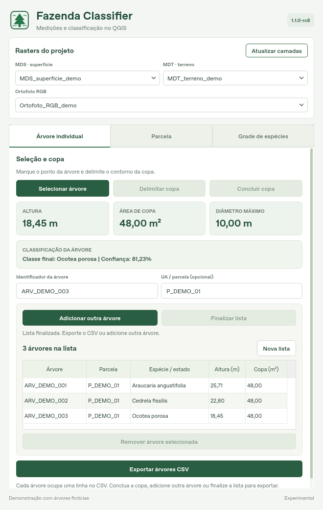
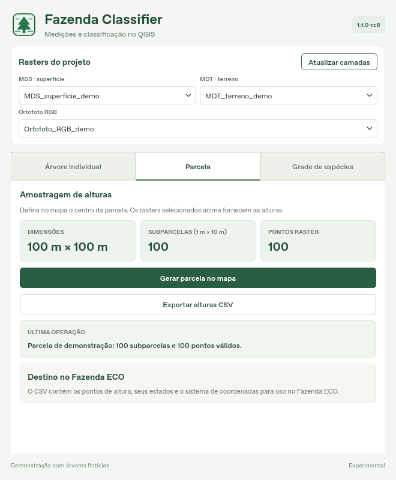

# Fazenda Classifier

Complemento experimental do QGIS para inventário florestal e sensoriamento
remoto com VANTs: parcelas, alturas MDS–MDT, morfometria de copas e
classificação opcional de espécies por CNN.

**Autor:** Leonardo Heraki · **Versão:** 1.1.0-rc8 · **Licença:** GPL-2.0-or-later

## Download e instalação

**[Baixar ZIP instalável — Fazenda Classifier RC8](downloads/fazenda_classifier_1.1.0-rc8.zip?raw=true)**

No QGIS: **Complementos → Gerenciar e Instalar Complementos → Instalar a
partir de ZIP**. Selecione o arquivo acima e reinicie o QGIS. O pacote contém
`fazenda_classifier/` na raiz e não precisa ser extraído ou recompactado.
**Code → Download ZIP** fornece o repositório completo, com outra estrutura.

Compatibilidade declarada: **QGIS 3.36 a 3.x**. Testes nativos executados em
QGIS 3.40.6/Linux; o autor confirmou o funcionamento da interface, dos CSVs
e da integração com o Fazenda ECO no seu ambiente Windows. QGIS 4 não foi validado.

## Ferramentas

- **Parcela:** dimensões de 100 m × 100 m, com 100 pontos e subparcelas de
  1 m × 10 m. A altura corresponde ao máximo do MDS na janela, menos o MDT
  amostrado na mesma localização física.
- **Árvore individual:** seleção do ponto, delimitação manual da copa, altura
  pontual MDS–MDT, área plana e maior distância entre vértices.
- **Lista de árvores:** após concluir uma copa, adicione outra árvore ou
  finalize a lista. Revise, remova seleções e exporte várias árvores no mesmo CSV.
- **Classificação opcional:** Araucaria angustifolia, Cedrela fissilis e
  Ocotea porosa, com modelo externo Fazenda LeNet compatível e limiar 0,60.
- **Grade de espécies:** diagnóstico de recortes RGB, separado das copas
  individuais e dos pontos de altura.

Seletores de MDS, MDT e RGB ficam no topo. As três abas têm rolagem própria;
cartões apresentam as medidas. Vírgulas decimais na interface não alteram
a precisão dos arquivos exportados.





## Integração com Fazenda ECO revisão 9

| Origem | Destino no Fazenda ECO |
| --- | --- |
| Exportar alturas CSV | **Parcelas — Alturas e dados climáticos** |
| Exportar árvores CSV | **Árvore por copa** |
| Resultado CSV de Árvore por copa, gerado pelo app | **Inventário por DAP** |
| Exportar diagnóstico CSV | Conferência da classificação RGB; não é entrada de inventário |

O Classifier exporta medições; o **Fazenda ECO** executa as equações de DAP e
carbono. No Inventário por DAP, o app importa os DAPs preditos no processamento
anterior. UA, área representada e tipologia são completadas no app se ausentes.
Esses resultados mantêm a identificação de **DAP predito pela copa**.
O fluxo recebe um CSV por cálculo, sem arquivo adicional de apoio.

Campos, unidades e procedimento: [guia dos CSVs](fazenda_classifier/CSV_FAZENDA_ECO.md).

## Dependências e modelo

Parcelas, alturas e medidas de copa usam **QGIS e NumPy**. A classificação
opcional requer **PyTorch, torchvision compatível e Pillow** no Python do QGIS.
O ambiente do autor foi testado com PyTorch 2.10.0 e torchvision 0.25.0 para CPU.
O plugin não instala ou troca bibliotecas automaticamente e não impõe bloqueio
por número de versão do PyTorch.

Os pesos treinados privados do autor **não são distribuídos**. O usuário
fornece um `state_dict` compatível com a arquitetura Fazenda LeNet, a ordem
das três classes e o pré-processamento definidos em `fazenda_model.py`.
O carregamento usa `weights_only=True`. Consulte o
[manual incluído no pacote](fazenda_classifier/README.txt).

## Interpretação científica

As ferramentas de medição continuam disponíveis sem um modelo de classificação.
O perfil de copas para o Fazenda ECO exige uma classificação final aceita;
o relatório completo preserva também os diagnósticos e medições sem classificação.
O Classifier não calcula H5, DAP, AGC ou projeções climáticas.

Pontos raster não identificam árvores individuais. A grade RGB não é uma
contagem de árvores: os recortes se sobrepõem. Confiança da CNN não equivale
a acurácia de campo. Transformações horizontais de SRC não corrigem diferenças
de datum vertical; MDS e MDT precisam usar metros e referenciais verticais compatíveis.
As medições e relações alométricas exigem validação adequada ao estudo.

Os resultados são gravados em camadas próprias de memória. Salve as camadas
em GeoPackage para preservá-las. Camadas externas e saídas antigas não são
adotadas para escrita. A reclassificação prepara todos os novos resultados
antes de substituir a saída anterior. Cada processamento usa um diretório
temporário independente; os CSVs podem registrar coordenadas e caminhos locais.

## Construção e verificação

```bash
python scripts/build_plugin.py
```

O ZIP instalável é gerado em `dist/fazenda_classifier_1.1.0-rc8.zip`.
A cópia publicada fica em `downloads/`.

```bash
FAZENDA_ECO_ROOT=/caminho/Fazenda_ECO python -m unittest discover -s fazenda_classifier/tests -p 'test_*.py'
```

A verificação desta publicação inclui 79 testes automatizados, seis deles de
integração HTTP com Fazenda ECO revisão 9, e 25 verificações nativas em QGIS
3.40.6 com dados fictícios. Os pesos privados não fazem parte dos testes
públicos. Esses testes verificam implementação e interoperabilidade; não
constituem calibração das equações ou validação ecológica em campo.

[Alterações da versão](CHANGELOG.md) · [Reportar problema](https://github.com/leonardoheraki/fazenda-classifier/issues)
